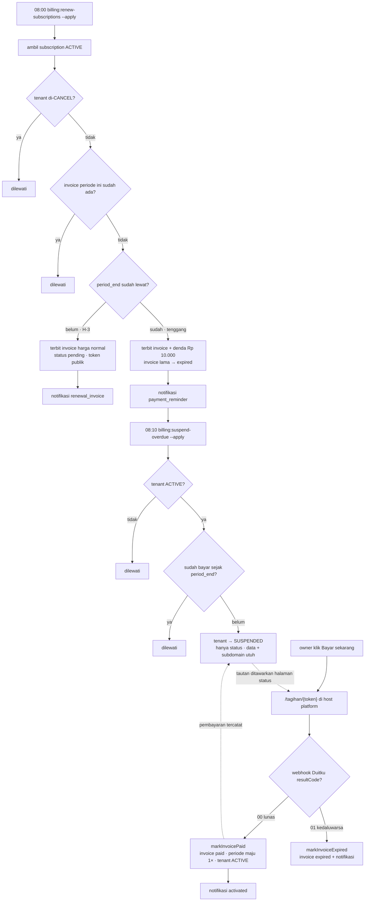
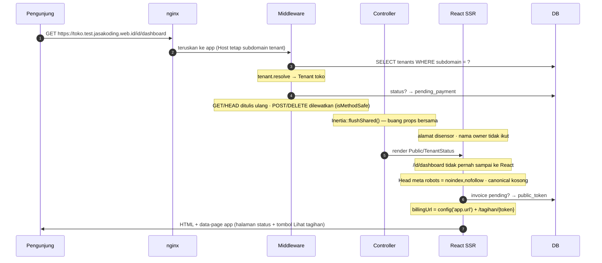

# Diagram — Siklus Hidup Tenant & Tagihan

Tiga diagram untuk fitur **"Siklus Hidup Tenant yang Kelihatan User"** (Task 1–7).
Digenerate dari kode, bukan karangan: rute, middleware, dan aturan billing dibaca langsung dari
`routes/web.php`, `app/Http/Kernel.php`, `app/Tenancy/BillingRenewalService.php`,
`app/Http/Controllers/Api/SubscriptionWebhookController.php`.

| File | Isi | Dipakai untuk |
|---|---|---|
| `01-data-flow.png` | Peta aliran data & komponen (dua host, satu aplikasi) | jelaskan arsitektur ke orang baru |
| `02-flowchart.png` | Alur keputusan billing: terbit → tenggang → suspend → bayar | jelaskan aturan bisnis (B1–B7) |
| `03-sequence.png` | Sekuens satu permintaan nyata: dashboard tenant yang disuspend | jelaskan kenapa susunannya begitu |

Semua PNG: 2× resolusi, palet MD3 tonal dark `tailwind.config.js` (tanpa gradien, radius nyaris siku,
uang & tanggal mono). Sumber SVG ada di `<nama>.html` — buka di browser kalau perlu diperbesar.
Sumber Mermaid di bawah ini yang jadi rujukan teks (mudah di-diff di PR).

## Fakta yang dikunci diagram

**Dua host, satu aplikasi**

- `test.jasakoding.web.id` — host platform. `/tagihan/{token}` HANYA hidup di sini; host lain → 404.
- `{sub}.test.jasakoding.web.id` — subdomain tenant. Yang tampil tergantung status tenant, bukan URL-nya.

**Status tenant** (`tenants.status`)

- `pending_payment` · `active` · `suspended` · `cancelled` (→ 404)
- Suspend **hanya** mengubah status: data, invoice, dan subdomain tetap utuh.

**Status invoice** (`subscription_invoices.status`)

- `pending` · `paid` · `expired`
- `public_token` string(64) unique, **tidak dirotasi** selama umur invoice.
- Tabel tidak punya `tenant_id` — tenant dijangkau lewat `subscription_id → subscription→tenant`.

**Aturan billing (B1–B7)**

- B1 invoice terbit H-3 dari `current_period_end`
- B2 batas bayar +3 hari setelah periode habis
- B3 suspend **tenant saja** — bukan data, bukan subdomain
- B4 subdomain jangan dilepas saat suspend
- B5 harga saat pembuatan invoice (bukan harga saat dibayar)
- B6 tiga notifikasi: terbit · peringatan tenggang · suspend
- B7 denda flat Rp 10.000

**Enam event notifikasi** (`SendTenantNotificationJob`)

`registration_invoice` · `activated` · `renewal_invoice` · `payment_reminder` · `suspended` · `invoice_expired`

Semuanya dikirim lewat `EmailNotificationService` (SMTP jasakoding.web.id) dan
`WhatsappNotificationService` (OpenWA session `notification`). Template memakai `{payment_url}`.

## Empat jebakan yang terbukti di staging

1. **`route()` polos menempelkan host request.** Dipanggil dari subdomain tenant, tautan `/tagihan`
   jadi host tenant → `RequirePlatformHost` mem-404-kannya. Tautan lintas-host harus memakai
   `config('app.url')` yang ditempel manual (`platformUrl()` di `ResolvesTenantHost`).
   Ditemukan runtime, bukan test — test lama cuma meng-assert `'/tagihan/'`.
2. **`tenant.inactive` harus terpasang di grup `/` DAN `/id`.** Tanpa itu, 404-nya cuma pindah ke `/id`.
3. **Tautan bayar ditentukan oleh ada/tidaknya invoice `pending`, BUKAN status tenant.**
   Justru `pending_payment` yang paling butuh jalan bayar.
4. **Rute ber-`throttle` harus resolusi token manual.** `SubstituteBindings` jalan lebih dulu,
   jadi limiter per-token tidak pernah menghitung token yang salah.

## Sumber Mermaid

### 1. Aliran data

```mermaid
graph TD
    P[Pengunjung<br/>tanpa login] --> N[nginx-proxy-manager<br/>TLS wildcard]
    O[Owner tenant<br/>login] --> N
    A[Admin platform<br/>Filament] --> N
    C[Cron harian<br/>08:00 · 08:10 WIB] --> N

    N --> HP[HOST PLATFORM<br/>test.jasakoding.web.id]
    N --> ST[SUBDOMAIN TENANT<br/>{sub}.test.jasakoding.web.id]

    HP --> R1["/tagihan/{token}<br/>host platform saja, lain 404"]
    HP --> R2["/ dan /id/*<br/>selalu platform"]

    ST --> R3["/<br/>tenant.inactive → tenant.required → storefront"]
    ST --> R4["/id/*<br/>tenant.inactive ikut di sini"]

    R3 --> TPL[TenantShell.jsx<br/>Public/TenantStatus]
    R4 --> TPL
    R1 --> BL[Public/TenantBilling]

    TPL --> INV[(SubscriptionInvoice<br/>public_token · pending/paid/expired)]
    BL --> INV
    TPL --> TEN[(Subscription / Tenant<br/>current_period_end · status)]

    INV --> JOB[SendTenantNotificationJob<br/>6 event]
    TEN --> JOB
    JOB --> EM[EmailNotificationService]
    JOB --> WA[WhatsappNotificationService]
```

### 2. Alur keputusan billing



### 3. Sekuens — dashboard tenant yang sudah disuspend



## Regenerate

`01`–`03` dibangun sebagai SVG lalu dirender headless. Kalau mengubah kode, ulangi:

```bash
CHROME=~/.cache/ms-playwright/chromium-1223/chrome-linux64/chrome
$CHROME --headless --no-sandbox --disable-gpu --hide-scrollbars \
  --force-device-scale-factor=2 --window-size=1680,1530 \
  --screenshot=03-sequence.png file://$PWD/03-sequence.html
```
